# NOA — Catatan Kandang Plasma

> **Nitip, Openi, Adil.** Aplikasi web untuk **peternak plasma ayam broiler**: mencatat kandang setiap hari dengan mudah, lalu menyandingkan angka sendiri dengan **RHPP** (rekap hasil panen) dari inti, baris demi baris.

Proyek mata kuliah **Pengembangan Aplikasi Web Lanjut**. Dibangun dengan Laravel 13, PostgreSQL, Blade, Alpine.js, dan Tailwind CSS.

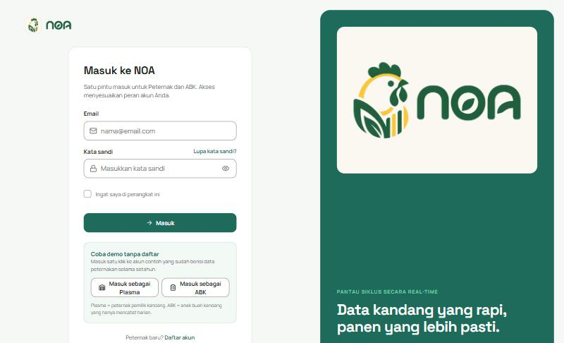

## Masalah yang diselesaikan

Peternak plasma memelihara ayam milik **inti** (perusahaan). Di akhir siklus, inti menerbitkan RHPP yang berisi hasil, biaya, dan pendapatan. Peternak biasanya **tidak punya catatan sendiri yang rapi** untuk dibandingkan, sehingga sulit memeriksa atau menegosiasikan angka tersebut.

NOA memberi peternak catatan harian yang cepat (kurang dari satu menit), menghitung performa otomatis (FCR, IP, deplesi, biaya per kg), lalu mencocokkannya dengan RHPP: mana yang **sama**, mana yang **berbeda**, lengkap dengan keterangan dan lembar cetak untuk musyawarah.

## Coba sekarang (mode demo)

Di halaman masuk tekan **Masuk sebagai Plasma** atau **Masuk sebagai ABK** (tanpa mengetik sandi). Akun demo berisi **4 kandang dan 14 siklus selama ±14 bulan** (546 catatan harian, 42 tahap panen) yang mencakup semua status. Tombol **Kembalikan data demo** di bilah atas mengembalikan data ke keadaan awal.

| Peran | Email | Sandi |
|---|---|---|
| Plasma (peternak) | `simulasi@noa.test` | `password` |
| ABK (anak buah kandang) | `abk.simulasi@noa.test` | `password` |

## Fitur utama

| | |
|---|---|
| **Catatan harian cepat** | Tiga isian (pakan, ayam mati, afkir), tombol +/−, **Samakan dengan kemarin**, dan **isi banyak hari sekaligus**. Berjalan nyaman di ponsel (isian 16 px, tombol ≥ 44 px). |
| **Siklus dari awal sampai tutup** | Wizard 5 langkah, ringkasan, sampling bobot, OVK, panen bertahap + nomor BTPA, input RHPP, tutup siklus, tutup tanpa RHPP, atau hentikan dini. Tujuh status dengan alur jelas. |
| **Rekonsiliasi RHPP** | 17 baris perbandingan (catatan peternak vs RHPP inti) dengan penanda Sama/Berbeda, keterangan per baris, dan lembar cetak A4. |
| **Performa** | FCR, IP, deplesi, biaya per kg per periode, tren antar-siklus (grafik garis + sparkline), dan **bandingkan dua siklus**. |
| **Mudah dipahami awam** | Tanda tanya penjelas istilah, halaman **Bantuan**, kartu **Langkah berikutnya**, **Mulai di sini**, **Perlu perhatian**, tur panduan, dan panel **Kenapa angkanya begini?** yang menunjukkan rumus dengan angka milik pengguna. |
| **Bagaimana kalau?** | Kalkulator interaktif: berapa pakan dan rupiah yang bisa dihemat bila FCR atau deplesi lebih baik. |
| **Peran dan keamanan** | Plasma dan ABK; ABK hanya mencatat di satu siklus dan tidak melihat biaya, kontrak, atau rekonsiliasi. Otorisasi dengan kebijakan Laravel. |
| **Tampilan** | Mode terang dan **gelap**, responsif (ponsel, tablet, desktop), notifikasi toast, jam di bilah atas, dan halaman galat 403/404/419/500. |
| **Unduhan** | Laporan siklus (CSV + cetak A4), daftar BTPA, rekap pembanding RHPP, dan riwayat recording. |

### Cuplikan

| Dashboard | Performa |
|---|---|
| 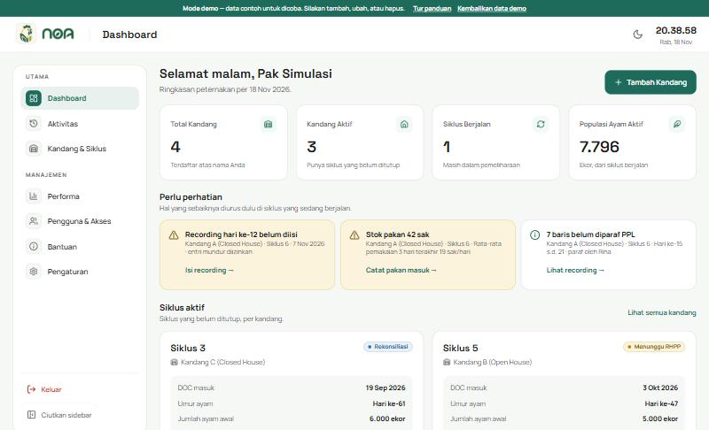 | 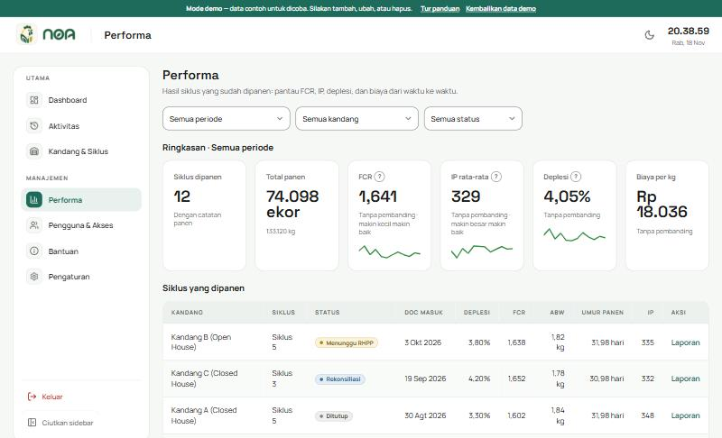 |

| Ringkasan siklus | Catatan harian |
|---|---|
| 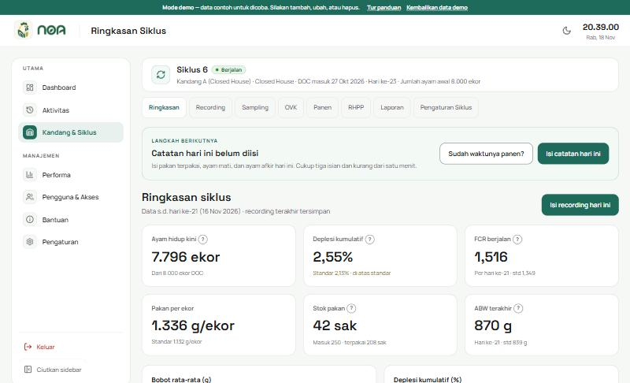 | 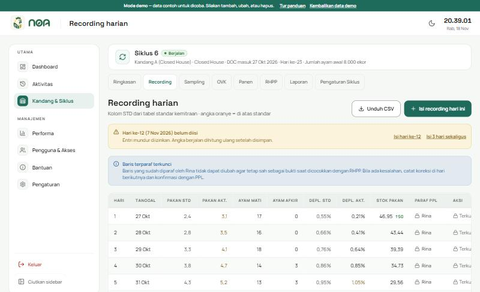 |

| Kurva harian | Rekonsiliasi RHPP |
|---|---|
| 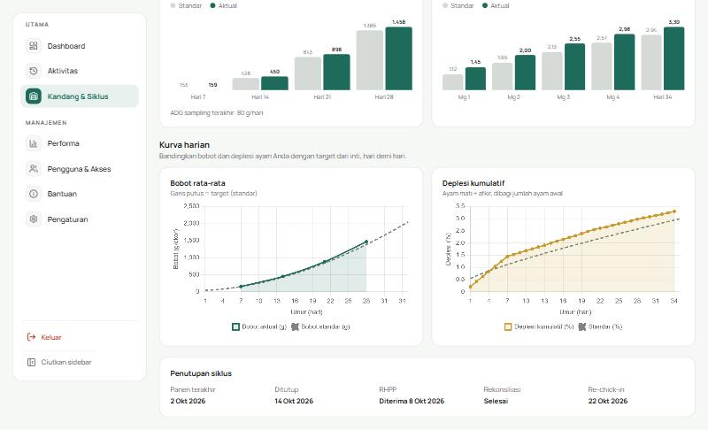 | 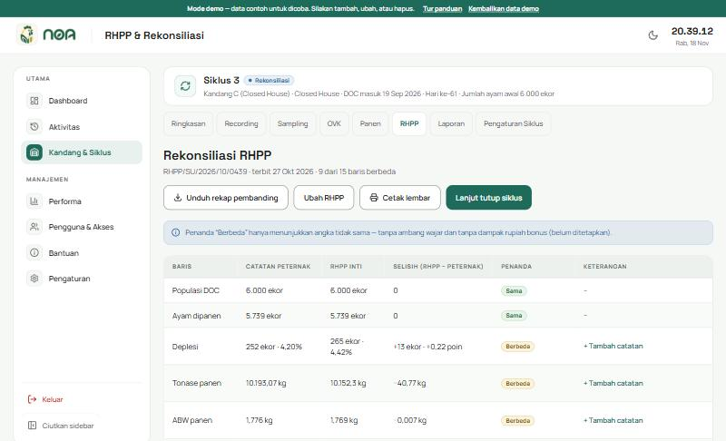 |

| Bagaimana kalau? | Bandingkan siklus |
|---|---|
| 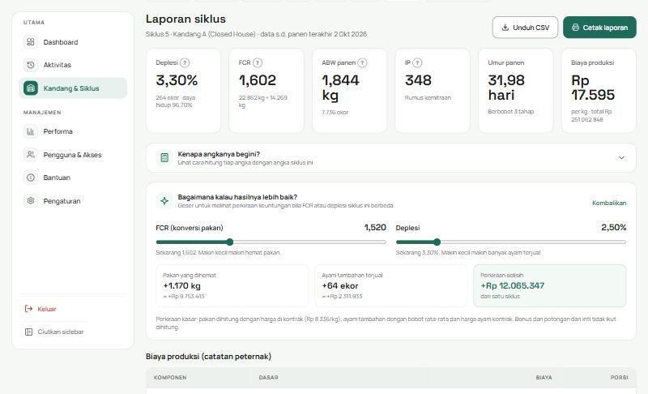 | 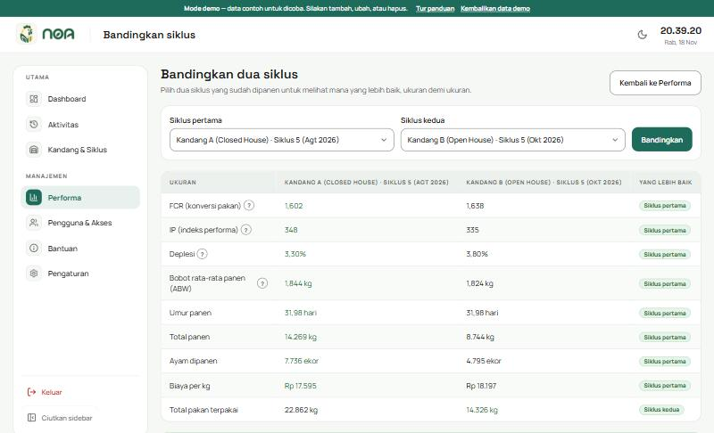 |

| Bantuan | Mode gelap + tur panduan | Input di ponsel |
|---|---|---|
| 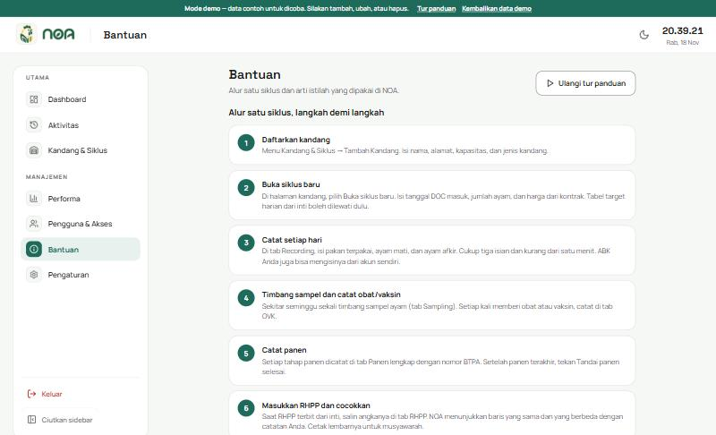 | 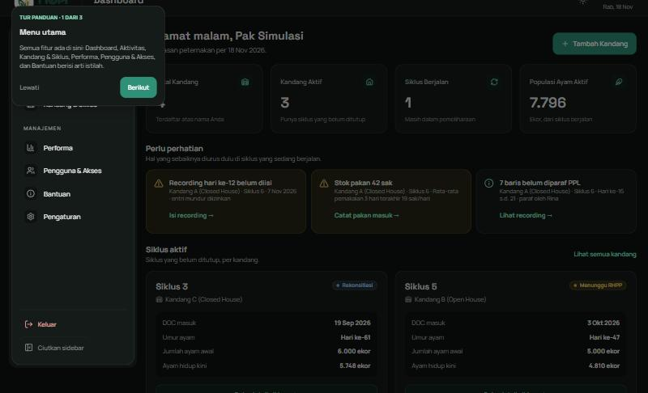 | 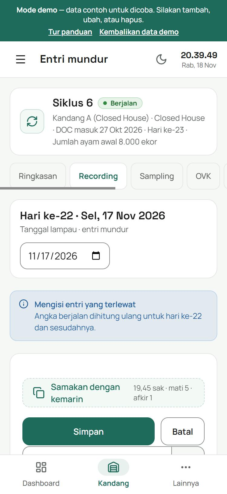 |

## Teknologi

- **Backend:** Laravel 13, PHP 8.3, PostgreSQL 17 (batasan CHECK, indeks unik parsial, kolom turunan di basis data)
- **Frontend:** Blade (komponen anonim), Alpine.js, Tailwind CSS 3 (token desain CSS variabel, tema terang/gelap), Vite, Chart.js (hanya di halaman grafik)
- **Autentikasi:** Laravel Breeze, kebijakan (`Policy`) per sumber daya
- **Pengujian:** PHPUnit, **442 tes fitur dan unit** (lihat [docs/PENGUJIAN.md](docs/PENGUJIAN.md))
- **Penayangan:** Vercel (runtime PHP komunitas) atau Render/Docker ([docs/DEPLOY.md](docs/DEPLOY.md))

## Menjalankan secara lokal

Prasyarat: PHP 8.3, Composer, Node 20+, Docker (untuk PostgreSQL).

```bash
git clone https://github.com/marquisccel/NOA.git && cd NOA
composer install && npm install
cp .env.example .env && php artisan key:generate
docker compose up -d            # PostgreSQL 17
php artisan migrate --seed
php artisan db:seed --class=SimulasiSeeder   # data demo (opsional)
npm run build
php artisan serve               # http://127.0.0.1:8000
```

Aktifkan tombol demo dengan `NOA_DEMO=true` di `.env`. Menjalankan tes: `php artisan test`.

## Dokumentasi

| Dokumen | Isi |
|---|---|
| [docs/ERD.md](docs/ERD.md) | Diagram basis data (Mermaid) dan penjelasan tabel |
| [docs/ALUR-SIKLUS.md](docs/ALUR-SIKLUS.md) | Diagram status siklus dan alur penutupan |
| [docs/ATURAN-BISNIS.md](docs/ATURAN-BISNIS.md) | Aturan bisnis R1–R13 dan rumus perhitungan |
| [docs/PENGUJIAN.md](docs/PENGUJIAN.md) | Strategi dan hasil pengujian |
| [docs/KEPUTUSAN-DESAIN.md](docs/KEPUTUSAN-DESAIN.md) | Alasan desain UI/UX dan teknis |
| [docs/DEPLOY.md](docs/DEPLOY.md) | Langkah penayangan di Vercel dan Render |
| [docs/NASKAH-DEMO.md](docs/NASKAH-DEMO.md) | Skenario demo ±8 menit |
| [docs/PRESENTASI.md](docs/PRESENTASI.md) | Kerangka slide presentasi |
| [PROGRESS.md](PROGRESS.md) | Catatan pengembangan per fase |

## Struktur proyek

```
app/
  Http/Controllers/   pengendali (Kandang, Siklus, Recording, Panen, Rhpp, Performa, ...)
  Models/             model Eloquent (Kandang, Siklus, RecordingHarian, Panen, Rhpp, ...)
  Policies/           otorisasi per sumber daya
  Services/           logika perhitungan (PerformanceCalculator, RingkasanPerforma, Rekonsiliasi, PerformaPeriode, ...)
database/             migrasi, pabrik, dan seeder (termasuk SimulasiSeeder)
resources/views/      tampilan Blade + komponen (x-kpi, x-alert, x-input-satuan, ...)
resources/js|css/     Alpine.js, Chart.js, token desain Tailwind
tests/Feature/        442 tes
docs/                 dokumentasi dan tangkapan layar
```

## Tim

Kelompok mata kuliah Pengembangan Aplikasi Web Lanjut — _isi nama anggota di sini_.
