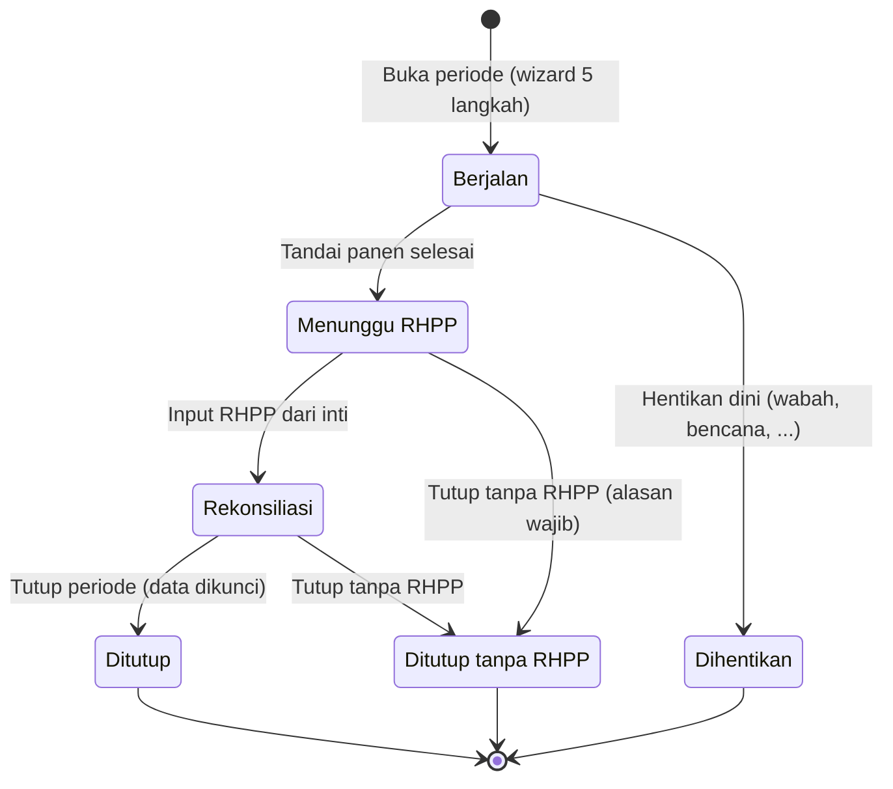
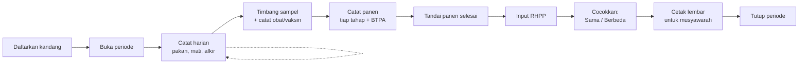

# Alur status periode

Satu periode = satu putaran memelihara ayam di satu kandang, dari DOC masuk sampai ditutup. Ada **7 status**. Empat pertama dianggap **terbuka** dan menahan kandang (tidak bisa membuka periode baru); tiga terakhir **terkunci** (data hanya bisa dilihat).

> Status `panen_selesai` ada di basis data sebagai cadangan, tetapi alur desain langsung ke **Menunggu RHPP**.

## Apa yang boleh di tiap status

| Status | Terbuka? | Catat harian | Sampling, OVK, panen | Input RHPP | Terkunci |
|---|---|---|---|---|---|
| Berjalan | ya | ya | ya | belum | tidak |
| Menunggu RHPP | ya | ya | ya | **ya** | tidak |
| Rekonsiliasi | ya | ya | ya | ya (ubah) | tidak |
| Ditutup | tidak | tidak | tidak | tidak | **ya** |
| Ditutup tanpa RHPP | tidak | tidak | tidak | tidak | **ya** |
| Dihentikan | tidak | tidak | tidak | tidak | **ya** (angka ditandai "tidak sebanding") |

## Alur kerja peternak (satu periode)

Kartu **Langkah berikutnya** di halaman Ringkasan Periode menunjuk tindakan yang sesuai dengan status dan data saat ini, sehingga pengguna baru tidak perlu menghafal alur ini.

## Alur rekonsiliasi RHPP

1. Peternak menyalin angka dari dokumen RHPP inti (16 isian wajib; lampiran opsional).
2. NOA membandingkan **15 baris**: populasi DOC, ayam dipanen, deplesi, tonase, ABW, umur panen, pakan masuk/terpakai/retur, FCR, IP, biaya DOC/pakan/OVK, pendapatan.
3. Bonus dan hasil bersih hanya **dicatat** dari RHPP (tidak dihitung NOA, karena rumus bonus tiap inti berbeda).
4. Tiap baris ditandai **Sama** atau **Berbeda** pada ketelitian tampilan. Tidak ada ambang "wajar" dan tidak ada dampak rupiah: NOA tidak memutuskan siapa yang benar, hanya memperlihatkan selisihnya.
5. Baris yang berbeda dapat diberi keterangan; semuanya tercetak di lembar A4 dengan kolom tanda tangan peternak, PPL, dan inti.
