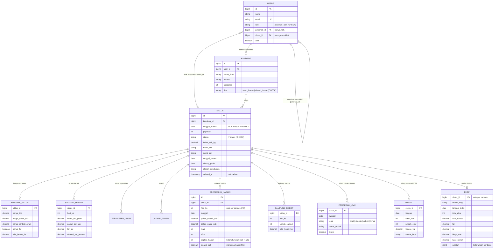

# Diagram basis data (ERD)

Basis data PostgreSQL. Aturan penting dijaga di basis data (bukan hanya di aplikasi): batasan `CHECK` pengganti enum, indeks unik parsial, dan kolom turunan.

## Keputusan basis data yang disengaja

| Keputusan | Alasan |
|---|---|
| `CHECK` alih-alih `enum` | Mudah diubah lewat migrasi tanpa menyentuh tipe; nilai tetap dikunci basis data. |
| Indeks unik parsial `siklus_satu_terbuka_per_kandang` (`WHERE status IN (4 status terbuka) AND deleted_at IS NULL`) | Menjaga aturan **satu periode terbuka per kandang** walau ada dua permintaan bersamaan. |
| Indeks unik parsial recording `(siklus_id, hari_ke)` | Menjaga **satu catatan per hari** (R1); data terhapus lunak tidak ikut memblokir. |
| `deplesi_harian` kolom turunan (generated) | Tidak mungkin tidak sinkron dengan `mati + afkir`. |
| Nilai turunan **tidak disimpan** (stok pakan, FCR, IP, deplesi %, selisih RHPP) | Selalu dihitung ulang dari catatan dasar sehingga tidak bisa basi. Lihat [ATURAN-BISNIS.md](ATURAN-BISNIS.md). |
| Soft delete pada data inti | Riwayat tetap ada untuk pembuktian. |
| `rhpp.catatan` bertipe `jsonb` | Keterangan per baris rekonsiliasi fleksibel tanpa tabel tambahan. |
